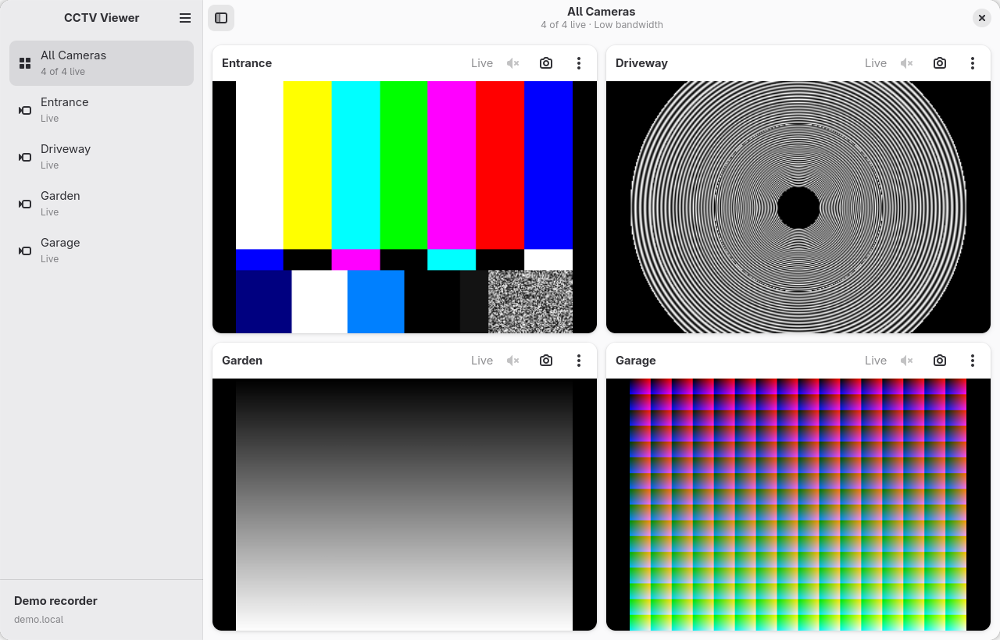
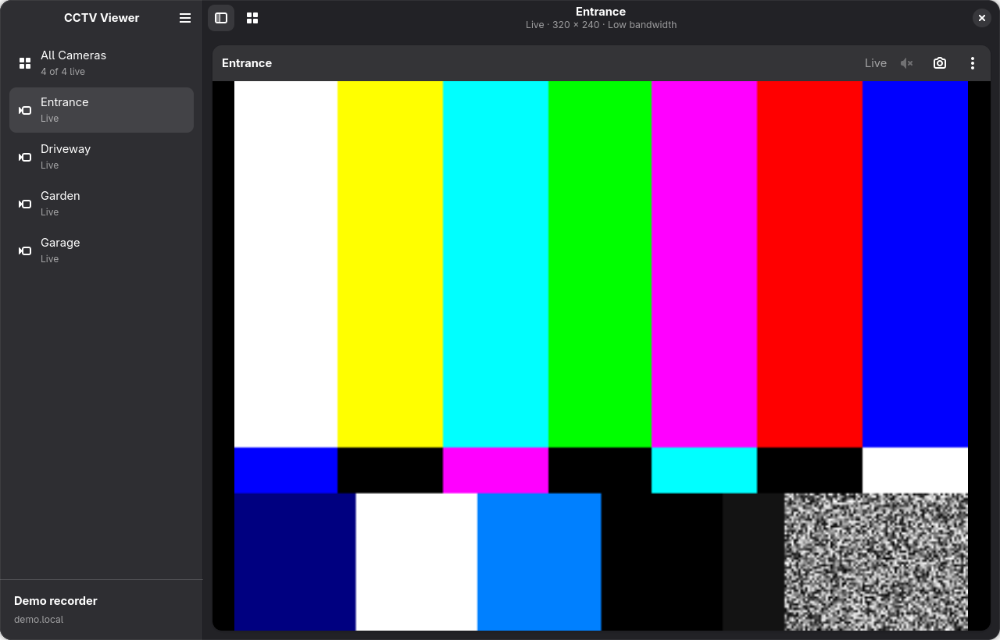
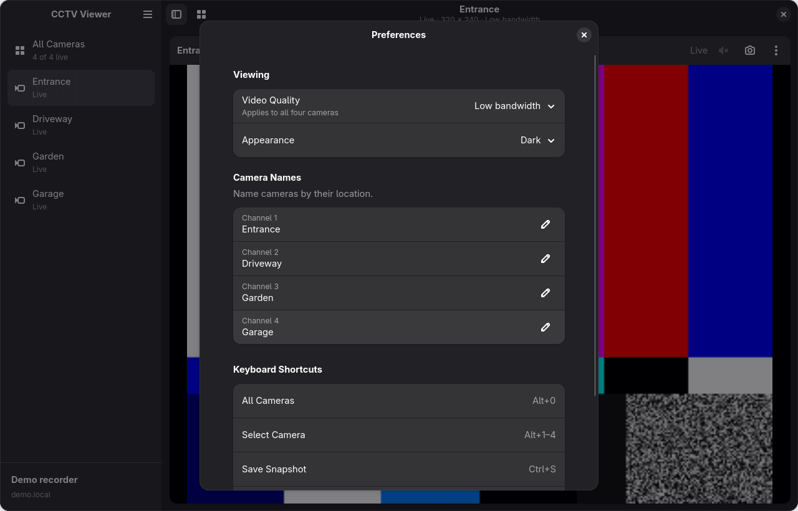

# CCTV Viewer

A small Linux camera viewer built with GTK4, libadwaita, and GStreamer.
View four CP PLUS DVR channels in a grid or focus on one camera, with snapshots,
audio controls, and local RTSP discovery.

This is an early prototype. It has been tested with a four-channel CP PLUS
recorder on Fedora 44 with GNOME Wayland. Other distributions and recorder
models have not been verified.

## Features

- Adaptive camera sidebar and four-camera grid.
- Main-stream or lower-bandwidth video, with hardware decoding when available.
- Per-camera volume controls; only one camera plays audio at a time.
- PNG snapshots saved to your Pictures/CCTV folder.
- Editable camera names and system, light, or dark appearance.
- Optional saved logins through the desktop Secret Service, such as GNOME Keyring.
- Discovery of RTSP services on the active home network.
- Original full-color and symbolic GNOME-style app icons.

## Screenshots

Actual app captures with synthetic demo feeds and temporary settings; no private
camera footage or credentials are shown.



<details>
<summary>Focused camera and preferences</summary>





</details>

## Requirements

| Component | Supported minimum | Version tested |
| --- | --- | --- |
| Python | 3.10 | 3.14.8 |
| GTK | 4.16 | 4.22.5 |
| libadwaita | 1.6 | 1.9.4 |
| GStreamer | 1.24 | 1.28.8 |
| GTK4 GStreamer sink | `gtk4paintablesink` plugin | 0.15.2 |
| PyGObject | System bindings for GTK, Adwaita, and GStreamer | 3.56.3 |
| libsecret | Optional, for saved logins | 0.21.8 |

The supported minimums are not a separately tested compatibility matrix.
The app checks the GTK, libadwaita, and GStreamer versions at startup.
libadwaita 1.6 supplies the [spinner widget](https://gnome.pages.gitlab.gnome.org/libadwaita/doc/1-latest/class.Spinner.html)
used in connection states.

Required GStreamer elements include `playbin`, `rtspsrc`, `rtph264depay`,
`h264parse`, `gtk4paintablesink`, and `avdec_h264`. Hardware decoding is preferred
when supported; the software decoder remains a fallback. An audio output plugin
and decoder for the recorder's audio format are needed for sound. This recorder
was tested with G.711 A-law and PulseAudio compatibility through PipeWire.

On Fedora, install the system packages:

```sh
sudo dnf install python3-gobject gtk4 libadwaita libsecret \
  gstreamer1 gstreamer1-plugins-base gstreamer1-plugins-good \
  gstreamer1-plugins-bad-free gstreamer1-plugin-gtk4 gstreamer1-plugin-libav
```

Codec package availability can depend on your enabled repositories. Use your
distribution's GTK/GStreamer packages; there is no `pip install` package yet.
Local network discovery uses iproute2 when available and Linux interface queries
otherwise.

## Run

From the cloned or downloaded project directory:

```sh
python3 viewer.py
```

Choose **Connect to Recorder**, or **Find Cameras on Network**. Enter your own
recorder address, RTSP port, username, and password. First-run credentials and
recorder addresses are empty.

To install the launcher and icons for the current checkout:

```sh
python3 tools/install.py
```

The installer writes to your user application and icon directories and requires
no administrator access. The checkout must remain in place. Run the installer
again after moving it; paths containing spaces are supported.

## Flatpak

Install from the signed [GitHub Pages repository](https://sh7vansh.github.io/cctv-viewer/):

```sh
flatpak install --user https://sh7vansh.github.io/cctv-viewer/cctv-viewer.flatpakref
flatpak run io.local.CCTVViewer
```

You can also [open the installer](https://sh7vansh.github.io/cctv-viewer/cctv-viewer.flatpakref)
in your software manager. Updates are delivered through the same repository
and verified with its signing key; use your software manager or `flatpak update`.
The published build currently targets x86_64 Linux desktops.

### Build locally

Build an installable bundle using the GNOME 51 runtime and SDK. Install the
build tools once (or use your distribution's `flatpak-builder`):

```sh
flatpak remote-add --user --if-not-exists flathub https://dl.flathub.org/repo/flathub.flatpakrepo
flatpak install --user flathub org.flatpak.Builder org.gnome.Sdk//51
python3 tools/build_flatpak.py
```

The output is `dist/cctv-viewer-0.2.0-ARCH.flatpak`, with a `.flatpak.sha256`
checksum alongside it. ARCH is your build machine's architecture. Install and run it with:

```sh
flatpak install --user dist/cctv-viewer-0.2.0-x86_64.flatpak
flatpak run io.local.CCTVViewer
```

The bundle includes the app, icons, launcher, and metadata; Flatpak installs the
GNOME runtime from Flathub as needed. No host Python packages are required to run
the installed app. Maintainers can follow the [signed publishing guide](packaging/README.md)
to update the hosted repository.

Sandbox permissions cover the network for RTSP/discovery, graphics devices,
Wayland or fallback X11, desktop audio, and
the `Pictures/CCTV` subdirectory for snapshots. The package has no general home
directory or host-command access. Saved logins use libsecret's sandbox backend
and the desktop Secret portal, without direct access to the host keyring bus.
Network discovery works without the host's
`ip` command. See the [manifest](io.local.CCTVViewer.json) for exact permissions.

Flatpak settings are separate from source-checkout settings, under
`~/.var/app/io.local.CCTVViewer/config/cctv-viewer/settings.json`. Configure the
recorder on first launch. The sandbox's encrypted credential store is separate
from native keyring entries; enter your login once and enable Remember Login.

To test an installed bundle without connecting to a recorder:

```sh
flatpak run io.local.CCTVViewer --demo --smoke-test
```

## Recorder compatibility

The viewer uses the following CP PLUS RTSP URL format for channels 1–4:

```text
rtsp://RECORDER:PORT/cam/realmonitor?channel=1&subtype=0
```

Username and password are passed separately. High quality uses `subtype=0`;
low bandwidth uses `subtype=1`. Change quality in Preferences; the cameras
reconnect when the dialog closes.

This is not a universal ONVIF client. Discovering an RTSP port does not guarantee
that a device supports this stream path. Custom stream paths, other channel
counts, archive playback, recording, PTZ, and InstaOn P2P connections are not
implemented. Remote viewing needs a reachable network path to the recorder.

Discovery checks ports 554, 8554, and 10554 on at most one directly connected
private IPv4 `/24` or smaller subnet. It uses bounded concurrent connections,
performs no login attempts, and stops when its dialog closes.

## Audio and snapshots

Each camera has a speaker button with a volume slider. All cameras start muted.
Raising one camera's volume mutes the others; switching to another focused camera
mutes the previous one. Cameras without an audio track have disabled controls.
Reconnect and disconnect reset audio to muted.

Use a camera's snapshot button, or focus it and press Ctrl+S. PNG files are saved
to Pictures/CCTV; the confirmation provides an Open action.

## Settings and saved logins

Preferences are stored outside the checkout at
`$XDG_CONFIG_HOME/cctv-viewer/settings.json`, defaulting to
`~/.config/cctv-viewer/settings.json`. These include the recorder address, port,
username, camera names, quality, appearance, and whether to remember the login.
Passwords are never included in that JSON file.

**Remember Login** is opt-in. It stores the password in your desktop Secret
Service and reconnects automatically on future launches. **Forget Saved Login**
removes the saved password for the current recorder account. Without libsecret,
the viewer can still use a session-only password.

An optional `CCTV_PASSWORD` environment variable connects using the saved
recorder settings. A normal launch saves it to the keyring only if Remember Login
is enabled. Smoke tests and the benchmark do not write credentials to the keyring.
The project includes no recorder credentials or camera images.

## Keyboard shortcuts

| Shortcut | Action |
| --- | --- |
| Alt+0 | All cameras |
| Alt+1–4 | Select a camera |
| Ctrl+S | Save a snapshot of the selected camera |
| Ctrl+O | Connection settings |
| Ctrl+R | Reconnect |
| Ctrl+, | Preferences |
| F11 | Toggle fullscreen |
| Escape | Leave fullscreen and show all cameras |
| Ctrl+Q | Quit |

## Development and verification

```sh
python3 viewer.py --demo --smoke-test
python3 tests/verify_ui.py
python3 tests/verify_benchmark.py
python3 tests/verify_logins.py
python3 tests/test_discovery.py
python3 tests/test_install.py
```

UI, saved-login, and benchmark checks need a working graphical desktop session.
The demo uses test patterns. UI checks exercise camera navigation, snapshots, dialogs, adaptive
layout, error recovery, audio selection, and disconnect using temporary settings.
The benchmark regression check verifies startup does not write or delete credentials.
Saved-login checks use a simulated Secret Service to verify cancellation of
pending automatic connections. Discovery and launcher checks run without a
graphical session; launcher checks install and launch a stub from temporary
checkouts with special characters in their paths.
No camera or real credentials are required for these checks.

Regenerate the public screenshots with temporary settings and test-pattern feeds:

```sh
python3 tools/capture_screenshots.py
```

For a live playback check, use the configured recorder and a saved login or
provide `CCTV_PASSWORD` in the environment:

```sh
python3 viewer.py --smoke-test
python3 tools/benchmark.py --quality main --require-smooth --snapshot-check
```

The benchmark measures four streams after a four-second warmup: CPU, resident
memory, GTK main-loop responsiveness, delivered frame rate, and frame-update
spacing. Snapshot verification uses temporary storage. A normal benchmark run
does not write settings or keyring credentials. `--require-smooth` fails when any
camera's 95th-percentile frame gap exceeds 80 ms, a threshold intended for 25 fps
streams. `--unsynchronized` reproduces the old unpaced presentation for comparison.
Pipeline timestamp age is clock diagnostic data, not camera-to-screen latency.

Playback follows GStreamer's clock to smooth packet bursts, with a 200 ms RTSP
jitter buffer. On Linux, the app prefers VA-API H.264 decoding when available to
pass GPU buffers directly to GTK. Explicit `GST_PLUGIN_FEATURE_RANK` overrides
are respected. Performance and decoder availability vary by hardware.

## Project layout

```text
viewer.py                 GTK4/libadwaita UI and GStreamer playback
credentials.py            Secret Service integration
discovery.py              Local RTSP discovery
data/icons/               Full-color and symbolic SVG sources
tests/verify_ui.py        GTK and video integration checks
tests/verify_benchmark.py Credential persistence regression check
tests/verify_logins.py    Saved-login cancellation regression checks
tests/test_discovery.py   Sandbox interface-discovery tests
tests/test_install.py     Desktop launcher installation and path checks
tools/benchmark.py        Live playback performance measurements
tools/install.py          Launcher and icon installation
tools/build_flatpak.py    Flatpak build and bundle export
tools/publish_flatpak.py  Signed update repository and Pages files
tools/capture_screenshots.py Reproducible demo-only application captures
io.local.CCTVViewer.json  Flatpak manifest
packaging/               Flatpak launcher and AppStream metadata
```

## License

[MIT](LICENSE), including the original app icon assets. GTK, libadwaita,
GStreamer, and other system dependencies retain their own licenses.
